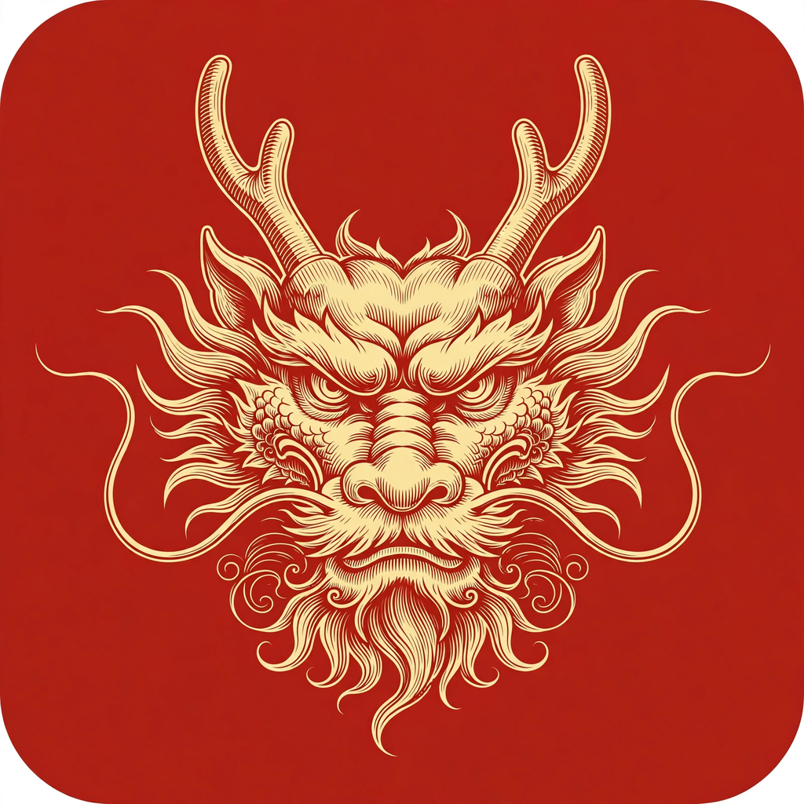

  

<h1 align="center">龙修图 · LongXiuTu</h1>

  <b>开源修图软件 PhotoCraft 的更名版 —— 界面与功能和原版一模一样，只换了名字和图标。</b> 
  十二生肖系列 · 龙

---

## 这是什么

龙修图基于开源项目 **[PhotoCraft](https://github.com/storytold/photocraft)**（ArtCraft 团队出品，对标 Photoshop 的纯 Rust 图像编辑器）的源代码编译而成：

- **改动只有两处**：名字（PhotoCraft → 龙修图）和图标（换成生肖龙的雕版插画图标）
- 界面布局、菜单、快捷键、功能、文件兼容性（PSD/PSB 分层打开保存等）与原版**完全一致，没有增删**
- 原版自带的 AI 操作接口全部保留：命令行工具、JSON 控制通道、MCP 服务器——每个功能都是命令，AI 可以直接驱动

之所以不自己重写界面：原版界面已经高度还原 Photoshop 的操作习惯，与其仿一个四不像，不如老老实实用原版代码。

## 下载

| 平台 | 下载（长期链接，始终指向最新版） |
|---|---|
| Windows x64 绿色版（免安装） | [LongXiuTu-Windows-x64.zip](https://github.com/longtime04/longxiutu/releases/latest/download/LongXiuTu-Windows-x64.zip) |

解压后双击 `longxiutu.exe` 运行。包内含配套命令行工具 `photocraft-cli.exe` 与《使用说明》（含 AI 接口用法）。

## AI 操作接口（原版自带）

- **命令行**：`photocraft-cli run / batch` 无界面批处理
- **MCP**：`photocraft-cli mcp` 起 MCP 服务器，AI 直接调用 500+ 个编辑命令
- **JSON 控制通道**：主程序加 `--control <端口>` 启动后，可经本机端口用 JSON 驱动正在运行的界面

详见包内《使用说明》。

## 系统要求与边界

- Windows 10/11 x64
- 原项目仍处早期阶段（alpha）：PSD 还原度持续完善中，个别高级功能与 Photoshop 尚有差距，重要文件请先用副本试
- 软件按「现状」提供，不作担保

## 许可与署名

- 本软件源自 PhotoCraft，遵循其 **MIT / Apache-2.0** 双许可，本仓库随附原许可证与 NOTICE
- 原项目：https://github.com/storytold/photocraft —— 功能有问题、提需求请优先去原项目，那边才是正主
- 龙修图由 Muse 协助制作：只做了更名、换图标与 Windows 打包，未改动任何功能代码
